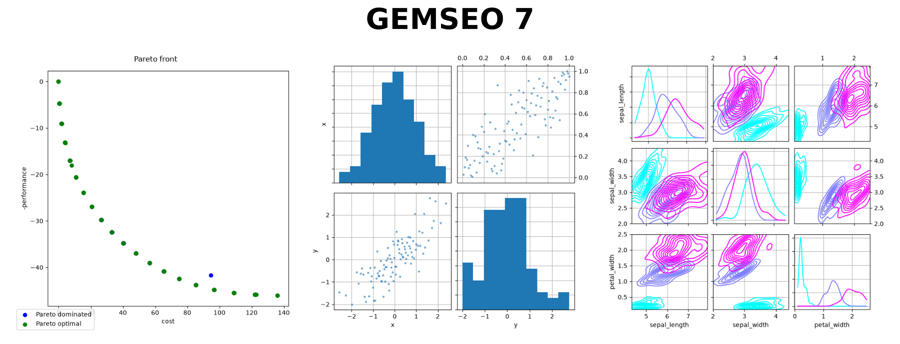
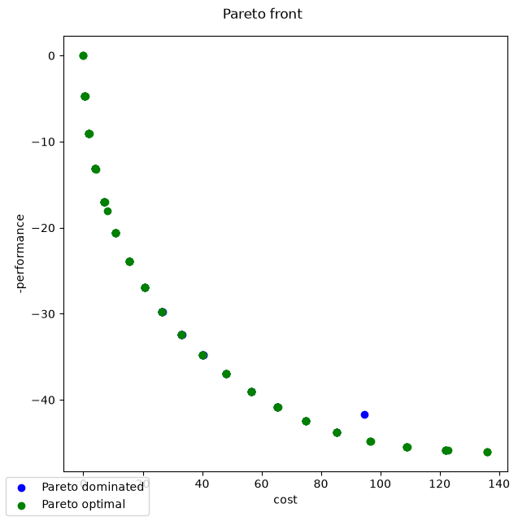
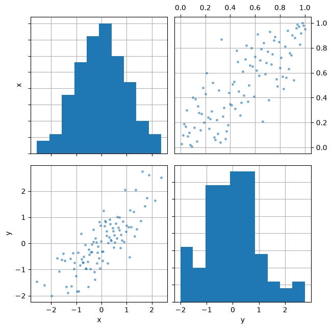
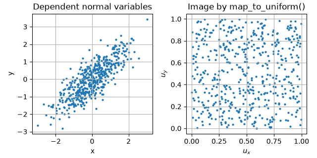
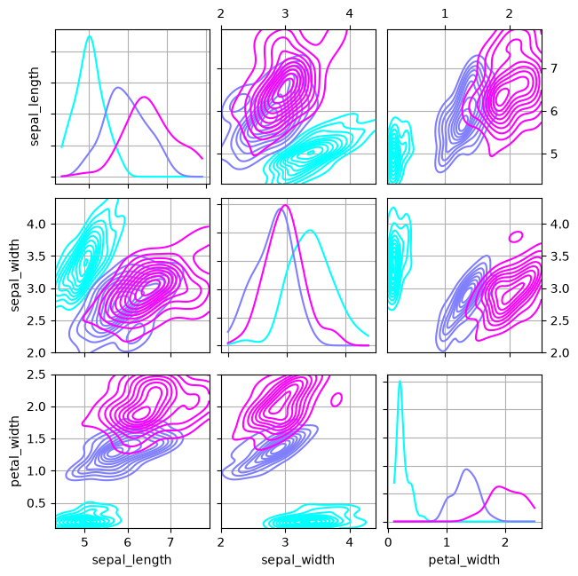

<!--
Copyright 2021 IRT Saint Exupéry, https://www.irt-saintexupery.com

This work is licensed under the Creative Commons Attribution-ShareAlike 4.0
International License. To view a copy of this license, visit
http://creativecommons.org/licenses/by-sa/4.0/ or send a letter to Creative
Commons, PO Box 1866, Mountain View, CA 94042, USA.
-->

# What's new in GEMSEO 7

GEMSEO 7 is a major release that revises the public API as a whole.
Its main changes
validate the configuration of a study before the first evaluation,
simplify the definition of scenarios and disciplines,
model uncertainties with the same tools as design variables,
extend the design variables to discrete, categorical and catalog ones,
and reduce the overhead of the library,
by a factor of up to 20 on cache-intensive workflows.
The [changelog](../changelog/index.md) lists every change of the release
and the guide [From GEMSEO 6 to GEMSEO 7](upgrading/6_to_7/index.md) details the migration.



```shell
pip install --upgrade gemseo[all]
```

<div class="grid cards clickable" markdown>

-   :material-package-variant:{ .lg .middle } [**Package structure**](#package-structure)

    ---

    Packages organized by domain,
    exposing their public classes, settings and factories.

-   :material-shield-check:{ .lg .middle } [**Validated settings**](#settings-validated-before-execution)

    ---

    Algorithms, MDAs, formulations and post-processors are configured
    with typed settings objects, validated at instantiation and at assignment.

-   :material-sitemap:{ .lg .middle } [**Scenarios**](#scenarios)

    ---

    One scenario class for optimization and DOE,
    multi-objective problems and scenarios used as disciplines.

-   :material-cube-outline:{ .lg .middle } [**Disciplines**](#disciplines)

    ---

    Grammars deduced from a Pydantic model,
    namespaces propagated over a group of disciplines.

-   :material-shape:{ .lg .middle } [**Mixed-variable design**](#mixed-variable-design-spaces)

    ---

    Discrete, categorical and catalog variables
    in addition to real and integer ones.

-   :material-dice-multiple:{ .lg .middle } [**Uncertainty quantification**](#uncertainty-quantification)

    ---

    A dedicated random space, dependent variables through copulas,
    discrete and joint distributions,
    reliability analysis and new sensitivity analyses.

-   :material-function-variant:{ .lg .middle } [**Derivatives**](#derivatives)

    ---

    Jacobian checkers for functions, disciplines and MDAs,
    forward, reverse and automatic modes in discipline chains.

-   :material-chart-scatter-plot:{ .lg .middle } [**Visualization**](#visualization)

    ---

    New pair plot options, a plotly heat map
    and figures following the matplotlib style.

-   :material-folder-search:{ .lg .middle } [**Debugging and traceability**](#debugging-and-traceability)

    ---

    The files of each execution in a directory tree mirroring the process,
    a detailed assessment of the constraints
    and the evaluations in the coordinates of the algorithm.

-   :material-rocket-launch:{ .lg .middle } [**Performance**](#performance)

    ---

    A DOE filling an HDF5 cache: 4 s instead of 78 s.
    Database access time independent of the history length.

</div>

## Package structure

GEMSEO 7 organizes its packages by domain:
[`gemseo.optimization`][gemseo.optimization], [`gemseo.doe`][gemseo.doe], [`gemseo.mda`][gemseo.mda],
[`gemseo.formulation`][gemseo.formulation], [`gemseo.scenario`][gemseo.scenario],
[`gemseo.space`][gemseo.space], etc.
Each package exposes its public classes, settings and factories at its top level,
so importing a class no longer requires knowing the module that defines it:

=== "GEMSEO 6"

    ```python
    from gemseo.algos.design_space import DesignSpace
    from gemseo.scenarios.mdo_scenario import MDOScenario
    from gemseo.settings.formulations import MDF_Settings
    from gemseo.settings.opt import SLSQP_Settings
    ```

=== "GEMSEO 7"

    ```python
    from gemseo.formulation import MDF_Settings
    from gemseo.optimization import SLSQP_Settings
    from gemseo.scenario import MDOScenario
    from gemseo.space import DesignSpace
    ```

Naming follows uniform rules across the library:
`MDOFunction` becomes [ArrayFunction][gemseo.core.function.array_function.ArrayFunction], the chains of disciplines become [DisciplineChain][gemseo.discipline.chain.chain.DisciplineChain],
enumeration members are in upper case and mappings are named `key_to_value`.

## Settings validated before execution

In GEMSEO 6, an unknown option, such as a misspelled `max_itre`, was ignored without notice:
the optimizer ran with its default number of iterations,
and the error appeared only once the study was over.

In GEMSEO 7, the algorithms, the MDAs, the MDO formulations, the post-processors,
the dataset plots, the probability distributions and the machine learning models
are configured with [Pydantic](https://docs.pydantic.dev) settings objects.
An unknown field or a value of a wrong type raises a `ValidationError`
when the settings object is created and whenever one of its fields is modified.
Each settings class declares its fields with their types, default values and descriptions,
which IDEs use for autocompletion and inline documentation.

```python
from gemseo.optimization import SLSQP_Settings

SLSQP_Settings(max_itre=100)
# ValidationError: 1 validation error for SLSQP_Settings
# max_itre
#   Extra inputs are not permitted [type=extra_forbidden, input_value=100, input_type=int]

settings = SLSQP_Settings(max_iter=100)
settings.max_iter = "many"
# ValidationError: 1 validation error for SLSQP_Settings
# max_iter
#   Input should be a valid integer, unable to parse string as an integer [type=int_parsing, input_value='many', input_type=str]
```

Settings are hierarchical.
Instead of an MDA name passed as a string and options passed as a dictionary,
the formulation receives the settings of its MDA,
which contain the settings of its linear solver, and so on.
The configuration of a process is thus defined, and validated, as a single object.
For example, an MDF formulation whose MDA chain solves each strongly coupled group
with a Newton-Raphson method using GMRES:

```python
from gemseo.formulation import MDF_Settings
from gemseo.linear import GMRES_Settings
from gemseo.mda import MDAChain_Settings
from gemseo.mda import MDANewtonRaphson_Settings

formulation_settings = MDF_Settings(
    main_mda_settings=MDAChain_Settings(
        inner_mda_settings=MDANewtonRaphson_Settings(
            tolerance=1e-8,
            newton_linear_solver_settings=GMRES_Settings(rtol=1e-10),
        )
    )
)
```

The machine learning models use settings objects, like the rest of the library:

=== "GEMSEO 6"

    ```python
    from gemseo.mlearning.regression.algos.linreg import LinearRegressor

    regressor = LinearRegressor(dataset, fit_intercept=False)
    ```

=== "GEMSEO 7"

    ```python
    from numpy import linspace

    from gemseo.dataset import IODataset
    from gemseo.machine_learning import LinearRegressor_Settings
    from gemseo.machine_learning.regression.model import LinearRegressor

    x = linspace(0.0, 1.0, 10)[:, None]
    dataset = IODataset()
    dataset.add_input_variable("x", x)
    dataset.add_output_variable("y", 2.0 * x + 1.0)
    regressor = LinearRegressor(
        dataset, settings=LinearRegressor_Settings(fit_intercept=False)
    )
    regressor.learn()
    ```

## Scenarios

### A more explicit API

A scenario is now built in three steps:
the disciplines, the design space and the formulation at construction;
the objective, the constraints and the observables through dedicated methods;
the algorithm settings at execution.
The objective is no longer a constructor argument:
[add_objective()][gemseo.scenario.mdo.MDOScenario.add_objective] declares it like the constraints and observables,
and supports maximization and groups of objectives.
[execute()][gemseo.scenario.mdo.MDOScenario.execute] returns the result of the algorithm,
which gives direct access to the optimum
without querying the optimization problem.

=== "GEMSEO 6"

    ```python
    from gemseo import create_discipline
    from gemseo.problems.mdo.sellar.sellar_design_space import SellarDesignSpace
    from gemseo.scenarios.mdo_scenario import MDOScenario

    scenario = MDOScenario(
        create_discipline(["Sellar1", "Sellar2", "SellarSystem"]),
        "obj",
        SellarDesignSpace(),
        formulation_name="MDF",
        main_mda_name="MDAGaussSeidel",
        main_mda_settings={"tolerance": 1e-8},
    )
    scenario.add_constraint("c_1", constraint_type="ineq")
    scenario.add_constraint("c_2", constraint_type="ineq")
    scenario.execute(algo_name="SLSQP", max_iter=100)
    scenario.post_process(post_name="OptHistoryView", save=False, show=False)
    ```

=== "GEMSEO 7"

    ```python
    from gemseo.formulation import MDF_Settings
    from gemseo.mda import MDAGaussSeidel_Settings
    from gemseo.optimization import SLSQP_Settings
    from gemseo.post import OptHistoryView_Settings
    from gemseo.problem.mdo.sellar import Sellar1, Sellar2, SellarDesignSpace, SellarSystem
    from gemseo.scenario import MDOScenario

    scenario = MDOScenario(
        [Sellar1(), Sellar2(), SellarSystem()],
        SellarDesignSpace(),
        formulation_settings=MDF_Settings(
            main_mda_settings=MDAGaussSeidel_Settings(tolerance=1e-8)
        ),
    )
    scenario.add_objective("obj")
    scenario.add_constraint("c_1", constraint_type="ineq")
    scenario.add_constraint("c_2", constraint_type="ineq")
    result = scenario.execute(SLSQP_Settings(max_iter=100))
    scenario.post_process(OptHistoryView_Settings(save=False, show=False))
    ```

### Multi-objective optimization

Multi-objective problems are declared with the same method.
Each call to [add_objective()][gemseo.scenario.mdo.MDOScenario.add_objective] adds an objective, to minimize or to maximize,
and the objectives may be computed by different disciplines.
The scenario concatenates them into a vector objective
solved by a multi-objective algorithm such as [MNBI][gemseo.optimization.mnbi.mnbi.MNBI],
and [execute()][gemseo.scenario.mdo.MDOScenario.execute] returns a result including the Pareto front:

```python
from gemseo.discipline import AnalyticDiscipline
from gemseo.optimization import MNBI_Settings
from gemseo.optimization import SLSQP_Settings
from gemseo.post import ParetoFront_Settings
from gemseo.scenario import MDOScenario
from gemseo.space import DesignSpace

cost_model = AnalyticDiscipline({"cost": "4*x**2+4*y**2"})
performance_model = AnalyticDiscipline({"performance": "50-(x-5)**2-(y-5)**2"})
design_space = DesignSpace()
design_space.add_real_variable("x", lower_bound=0.0, upper_bound=5.0, value=1.0)
design_space.add_real_variable("y", lower_bound=0.0, upper_bound=3.0, value=1.0)

scenario = MDOScenario([cost_model, performance_model], design_space)
scenario.add_objective("cost")
scenario.add_objective("performance", minimize=False)
result = scenario.execute(
    MNBI_Settings(
        max_iter=1000,
        n_sub_optim=20,
        sub_optim_algo_settings=SLSQP_Settings(max_iter=100),
    )
)
pareto_front = result.pareto_front
scenario.post_process(
    ParetoFront_Settings(
        objectives_labels=("cost", "-performance"), save=False, show=True
    )
)
```

{ width="400" }

[OptHistoryView][gemseo.post.opt_history_view.OptHistoryView] also supports these problems:
its objective plot draws one curve per objective, named in a legend.

### One scenario class for optimization and DOE

[MDOScenario][gemseo.scenario.mdo.MDOScenario] now covers both optimization and design of experiments:
it runs the algorithm corresponding to the settings passed to [execute()][gemseo.scenario.mdo.MDOScenario.execute].
Replacing a DOE by an optimizer only changes this argument:

=== "GEMSEO 6"

    ```python
    from gemseo import create_discipline
    from gemseo.algos.design_space import DesignSpace
    from gemseo.scenarios.doe_scenario import DOEScenario

    discipline = create_discipline("AnalyticDiscipline", expressions={"y": "x1+x2"})
    design_space = DesignSpace()
    design_space.add_variable("x1", lower_bound=0.0, upper_bound=1.0)
    design_space.add_variable("x2", lower_bound=0.0, upper_bound=1.0)

    scenario = DOEScenario(
        [discipline], "y", design_space, formulation_name="DisciplinaryOpt"
    )
    scenario.execute(algo_name="PYDOE_FULLFACT", n_samples=25)
    ```

=== "GEMSEO 7"

    ```python
    from gemseo.discipline import AnalyticDiscipline
    from gemseo.doe import PYDOE_FULLFACT_Settings
    from gemseo.scenario import MDOScenario
    from gemseo.space import DesignSpace

    discipline = AnalyticDiscipline({"y": "x1+x2"})
    design_space = DesignSpace()
    design_space.add_real_variable("x1", lower_bound=0.0, upper_bound=1.0)
    design_space.add_real_variable("x2", lower_bound=0.0, upper_bound=1.0)

    scenario = MDOScenario([discipline], design_space)
    scenario.add_objective("y")
    scenario.execute(PYDOE_FULLFACT_Settings(n_samples=25))
    ```

### Evaluation scenarios

For exploration studies,
the new [EvaluationScenario][gemseo.scenario.evaluation.EvaluationScenario] samples the disciplines without requiring an objective;
[observe_all_outputs()][gemseo.scenario.evaluation.EvaluationScenario.observe_all_outputs] records all their outputs:

```python
from gemseo.discipline import AnalyticDiscipline
from gemseo.doe import PYDOE_FULLFACT_Settings
from gemseo.scenario import EvaluationScenario
from gemseo.space import DesignSpace

discipline = AnalyticDiscipline({"y": "x1+x2", "z": "x1*x2"})
design_space = DesignSpace()
design_space.add_real_variable("x1", lower_bound=0.0, upper_bound=1.0)
design_space.add_real_variable("x2", lower_bound=0.0, upper_bound=1.0)

scenario = EvaluationScenario([discipline], design_space)
scenario.observe_all_outputs()
scenario.execute(PYDOE_FULLFACT_Settings(n_samples=25))
dataset = scenario.to_dataset()
```

### Scenarios as disciplines

Any scenario can be used as a discipline of another process.
[EvaluationScenarioAdapter][gemseo.scenario.adapter.evaluation.EvaluationScenarioAdapter] wraps an [EvaluationScenario][gemseo.scenario.evaluation.EvaluationScenario]:
its inputs overload the default inputs of the disciplines of the scenario,
and its outputs are those of the last point evaluated by the scenario.
[MDOScenarioAdapter][gemseo.scenario.adapter.mdo.MDOScenarioAdapter] derives from it and adds the features requiring an optimum:
the optimal objective value, the Lagrange multipliers and the post-optimal derivatives;
see [how to transform a scenario into a discipline](../generated/examples/howtos/scenario/plot_howto_scenario_adapter.md).
[wrap_scenario_in_job_scheduler()][gemseo.scenario.job_scheduler.wrap_scenario_in_job_scheduler] relies on this mechanism
to submit a whole scenario to an HPC cluster in one call:
it adapts the scenario into a discipline,
then wraps this discipline in a [JobSchedulerDiscipline][gemseo.discipline.wrapper.job_scheduler.discipline.JobSchedulerDiscipline].

### Bi-level formulations

The bi-level formulations accept user-defined MDAs,
and plain disciplines as sub-scenarios.

The history of a sub-scenario over all its executions
can be retrieved as a single dataset.

## Disciplines

### Grammars deduced from a Pydantic model

A [BaseModelDiscipline][gemseo.discipline.base_model_discipline.BaseModelDiscipline]
reads its inputs from and writes its outputs to a Pydantic model,
instead of dictionaries.
Its input and output grammars are deduced from the fields it reads and writes,
so they need not be declared,
and several disciplines can share the same model:

```python
from pydantic import BaseModel

from gemseo.discipline.base_model_discipline import BaseModelDiscipline


class Beam(BaseModel):
    length: float = 1.0
    width: float = 0.1
    height: float = 0.2
    density: float = 7800.0
    mass: float = 0.0


class BeamMass(BaseModelDiscipline):
    def _run_from_model(self, model: Beam) -> None:
        model.mass = model.density * model.length * model.width * model.height


discipline = BeamMass(Beam())
discipline.io.input_grammar.names  # density, height, length, width
discipline.io.output_grammar.names  # mass
discipline.execute({"length": 2.0})["mass"]  # 312.0
```

See [how to create a discipline from a Pydantic model](../generated/examples/howtos/disciplines/types/plot_howto_model_discipline.md)
for the rules that the method `_run_from_model` must follow.

### Namespaces propagated over a group of disciplines

Duplicating a group of coupled disciplines,
e.g. to evaluate a process at two operating points,
requires namespacing the variables of the copy
that must not be shared with the original group.
[propagate_namespace()][gemseo.discipline.namespace.propagate_namespace]
applies a namespace from seed variables
and propagates it forward along the coupling graph,
so that the couplings inside the group are preserved;
see [namespace propagation][concept-namespace-propagation].

### Undeclared outputs

By default,
a discipline ignores the outputs that its `_run` method returns
and that its output grammar does not declare.
Setting [forbid_extra_output_names][gemseo.core.discipline.base_discipline.BaseDiscipline.forbid_extra_output_names]
to `True` raises an `InvalidDataError` instead,
to detect an output misspelled in the code of the discipline.

## Mixed-variable design spaces

Engineering design variables are not all continuous:
a diameter is selected from a list of standard sizes,
a material among steel, aluminium and titanium,
a motor from a supplier's catalog.
GEMSEO 7 supports these variables natively.
[Discrete variables][concept-discrete-variables] take their values in a finite set of numbers,
categorical variables take a label, passed as such to the disciplines,
and [catalog variables][concept-catalog-variables] select a row in a table of alternatives.
Each type of variable has its own method, whose arguments are validated at call time:

```python
from pandas import DataFrame

from gemseo.space import DesignSpace

motors = DataFrame(
    {"power": [1.5, 3.0, 5.5], "mass": [12.0, 20.0, 31.0]},
    index=["M1", "M2", "M3"],
)

space = DesignSpace()
space.add_real_variable("thickness", lower_bound=0.1, upper_bound=1.0)
space.add_integer_variable("n_blades", lower_bound=2, upper_bound=8)
space.add_discrete_variable("diameter", (1.0, 4.0, 6.0, 9.0))
space.add_categorical_variable("material", ("steel", "aluminium", "titanium"))
space.add_catalog_variable("motor", motors)
```

The variable types are checked against the capabilities of the algorithm.
An optimizer restricted to real variables no longer rounds integer variables implicitly:
it raises an error, unless the user chooses to
[relax them into real variables][concept-integer-relaxation].
The result then also reports the optimum projected onto the declared domain,
with its objective value and its feasibility:
[x_opt_projected][gemseo.optimization.result.OptimizationResult.x_opt_projected],
[f_opt_projected][gemseo.optimization.result.OptimizationResult.f_opt_projected]
and [is_feasible_projected][gemseo.optimization.result.OptimizationResult.is_feasible_projected].

## Uncertainty quantification

The copulas and the reliability analysis presented below
rely heavily on [OpenTURNS](https://openturns.github.io/www/),
which provides their probabilistic models and algorithms.

### A dedicated random space

GEMSEO 6 described random variables with a `ParameterSpace`,
i.e. a design space extended with probability distributions,
whose bounds, current values and normalization have no meaning for random variables.
GEMSEO 7 introduces the [RandomSpace][concept-random-space],
defined by probability distributions only.
Design spaces and random spaces derive from a common base class,
so the DOE algorithms, the scenarios, the formulations and the sensitivity analyses
accept both without conversion.

=== "GEMSEO 6"

    ```python
    from gemseo import create_discipline, sample_disciplines
    from gemseo.algos.parameter_space import ParameterSpace
    from gemseo.settings.probability_distributions import SPNormalDistribution_Settings

    discipline = create_discipline("AnalyticDiscipline", expressions={"z": "x+y"})
    space = ParameterSpace()
    space.add_random_variable("x", SPNormalDistribution_Settings(mu=0.0, sigma=1.0))
    space.add_random_variable("y", SPNormalDistribution_Settings(mu=0.0, sigma=1.0))
    dataset = sample_disciplines(
        [discipline], space, "z", algo_name="PYDOE_LHS", n_samples=5
    )
    ```

=== "GEMSEO 7"

    ```python
    from gemseo.discipline import AnalyticDiscipline
    from gemseo.doe import PYDOE_LHS_Settings
    from gemseo.scenario import EvaluationScenario
    from gemseo.space import RandomSpace
    from gemseo.uncertainty.distribution import SPNormalDistribution_Settings

    discipline = AnalyticDiscipline({"z": "x+y"})
    space = RandomSpace()
    space.add_variable("x", SPNormalDistribution_Settings(mu=0.0, sigma=1.0))
    space.add_variable("y", SPNormalDistribution_Settings(mu=0.0, sigma=1.0))
    scenario = EvaluationScenario([discipline], space)
    scenario.add_observable("z")
    scenario.execute(PYDOE_LHS_Settings(n_samples=5))
    dataset = scenario.to_dataset()
    ```

### Dependent random variables

Uncertain quantities are often statistically dependent,
e.g. the yield strength and the Young's modulus of a material,
or the temperature and the pressure of a flow.
Assuming independence can underestimate the probability of failure of a design.
GEMSEO 7 models this dependence with a copula,
and the samples drawn from the random space,
for a DOE as for a sensitivity analysis, follow the resulting joint distribution.
[PairPlot][gemseo.post.dataset.pair_plot.PairPlot] can display the ranks of the data,
i.e. the empirical copula, in its upper part
to visualize the dependence structure.

```python
from openturns import CorrelationMatrix, NormalCopula

from gemseo.discipline import AnalyticDiscipline
from gemseo.doe import PYDOE_LHS_Settings
from gemseo.post.dataset import PairPlot
from gemseo.post.dataset.pair_plot_settings import PairPlot_Settings
from gemseo.scenario import EvaluationScenario
from gemseo.space import RandomSpace
from gemseo.uncertainty.distribution import OTNormalDistribution_Settings

space = RandomSpace()
space.add_variable("x", OTNormalDistribution_Settings(mu=0.0, sigma=1.0))
space.add_variable("y", OTNormalDistribution_Settings(mu=0.0, sigma=1.0))
correlation = CorrelationMatrix(2)
correlation[0, 1] = 0.8
space.add_copula(("x", "y"), NormalCopula(correlation))
print(space)

scenario = EvaluationScenario([AnalyticDiscipline({"z": "x+y"})], space)
scenario.add_observable("z")
scenario.execute(PYDOE_LHS_Settings(n_samples=100))
dataset = scenario.to_dataset()
print(dataset.get_view(variable_names=["x", "y"]).corr())
PairPlot(dataset, PairPlot_Settings(variable_names=("x", "y"), use_ranks=True)).execute(
    save=False, show=True
)
```

{ width="400" }

### Probability distributions

Discrete random variables have dedicated distributions:
[OTFiniteDiscreteDistribution][gemseo.uncertainty.distribution.openturns.finite_discrete.OTFiniteDiscreteDistribution]
defined by values and weights,
and [OTBernoulliDistribution][gemseo.uncertainty.distribution.openturns.bernoulli.OTBernoulliDistribution]
and [SPBernoulliDistribution][gemseo.uncertainty.distribution.scipy.bernoulli.SPBernoulliDistribution]
defined by the probability of a binary event.

Joint distributions are configured with settings objects,
[OTJointDistribution_Settings][gemseo.uncertainty.distribution.openturns.joint_settings.OTJointDistribution_Settings]
and [SPJointDistribution_Settings][gemseo.uncertainty.distribution.scipy.joint_settings.SPJointDistribution_Settings],
like the marginal ones.
Their methods [map_to_uniform()][gemseo.uncertainty.distribution.openturns.joint.OTJointDistribution.map_to_uniform]
and [map_from_uniform()][gemseo.uncertainty.distribution.openturns.joint.OTJointDistribution.map_from_uniform]
apply the Rosenblatt transformation,
which maps the random vector to the unit hypercube and back
taking into account the dependencies between its components.
With the random space of the previous section:

```python
from numpy import array

distribution = space.variables.distribution
samples = distribution.compute_samples(500)
uniform_samples = array([distribution.map_to_uniform(sample) for sample in samples])
```



### Reliability analysis

The mean and the variance of an output do not quantify
the probability of exceeding a threshold.
The new reliability analysis package estimates this probability.
A failure event is defined from thresholds on the outputs of the disciplines,
and its probability is estimated with the methods of OpenTURNS:
FORM and SORM, approximation methods requiring few evaluations;
Monte Carlo and quasi Monte Carlo sampling;
subset, importance and directional sampling, which target rare events.

### Sensitivity analysis

The sensitivity analyses accept a random space,
which they sample through its iso-probabilistic mapping.
[ROSobolAnalysis][gemseo.uncertainty.sensitivity.ro_sobol.ROSobolAnalysis] identifies the inputs driving a [rare event][concept-rosobol-analysis],
[FORMAnalysis][gemseo.uncertainty.sensitivity.form.FORMAnalysis] derives sensitivity indices from the importance factors of FORM,
[SobolAnalysis][gemseo.uncertainty.sensitivity.sobol.SobolAnalysis] can estimate its first-order indices
[from independent and identically distributed samples][concept-sobol-estimators],
and [plot_second_order()][gemseo.uncertainty.sensitivity.sobol.SobolAnalysis.plot_second_order] displays the second-order indices as a heat map.

## Derivatives

### Jacobian verification

[gemseo.check_jacobian()][gemseo.check_jacobian] compares the derivatives of a discipline
with a numerical approximation in one call.
It relies on dedicated checkers,
also usable directly:
[FunctionJacobianChecker][gemseo.util.derivative.check.function.FunctionJacobianChecker]
for an `ArrayFunction`,
[DisciplineJacobianChecker][gemseo.util.derivative.check.discipline.DisciplineJacobianChecker]
for a discipline
and [MDAJacobianChecker][gemseo.util.derivative.check.mda.MDAJacobianChecker]
for an MDA.

### Forward and reverse modes in discipline chains

A [DisciplineChain][gemseo.discipline.chain.chain.DisciplineChain]
computes its Jacobian by applying the chain rule to those of its disciplines.
In addition to the reverse mode,
it now supports the forward mode,
which is less expensive when the chain has fewer inputs than outputs.
The default mode,
[ChainDerivationMode.AUTO][gemseo.discipline.chain.chain.ChainDerivationMode],
selects the mode from the total sizes of the inputs and outputs.

## Visualization

[PairPlot][gemseo.post.dataset.pair_plot.PairPlot], formerly `ScatterMatrix`,
can replace its scatter plots by density contours (`use_scatter=False`).
With a `classifier`,
the histograms or the densities of its diagonal are superimposed by category:

```python
from gemseo.post.dataset import PairPlot
from gemseo.post.dataset.pair_plot_settings import PairPlot_Settings
from gemseo.problem.dataset.iris import create_iris_dataset

dataset = create_iris_dataset()
settings = PairPlot_Settings(
    variable_names=("sepal_length", "sepal_width", "petal_width", "specy"),
    classifier="specy",
    use_scatter=False,
    use_kde=True,
)
PairPlot(dataset, settings).execute(save=False, show=True)
```



[Heatmap][gemseo.post.dataset.heatmap.Heatmap], formerly `ColorEvolution`,
represents the variables of a dataset with a color scale.
In addition to matplotlib,
it now has a plotly backend, used for an HTML output (`file_format="html"`).

The optimization post-processors accept the `use_best_iteration_history` setting.
At each iteration,
they then plot the best design found up to this iteration,
feasible if any,
instead of the design evaluated at this iteration.

The figures follow the matplotlib style, including a dark one.
[ConstraintsHistory][gemseo.post.constraints_history.ConstraintsHistory],
[ParallelCoordinates][gemseo.post.parallel_coordinates.ParallelCoordinates],
[VariableInfluence][gemseo.post.variable_influence.VariableInfluence]
and [Boxplot][gemseo.post.dataset.boxplot.Boxplot]
take the colors of their reference lines and grids from the matplotlib settings
(`axes.edgecolor` and `grid.color`) instead of fixed black and grey,
and the marks of `OptHistoryView` are readable on light and dark backgrounds.

## Debugging and traceability

### Traceable working directories

Disciplines wrapping executables write files at each execution,
and locating those of a given iteration among thousands of directories was tedious.
[The directory manager][the-directory-manager] organizes them
into a tree that mirrors the process:
one directory per scenario, per iteration or sample, per MDA iteration and per discipline execution,
each with a trace of the executions it contains:

```txt
├── MDOScenario
│   ├── Optimizer_iteration_1
│   │   ├── MDAJacobi
│   │   │   ├── MDAJacobi_iteration_0
│   │   │   │   ├── Sellar1_execution
│   │   │   │   └── Sellar2_execution
│   │   │   │       └── y_1.txt
│   │   │   ├── MDAJacobi_iteration_1
│   │   │   │   ├── Sellar1_execution
│   │   │   │   └── Sellar2_execution
│   │   │   │       └── y_1.txt
│   │   │   └── ...
│   │   └── SellarSystem_execution
│   ├── Optimizer_iteration_2
│   └── ...
```

Once enabled with `configuration.directory_manager.enable = True`,
the files of a failed evaluation are located from its position in the process.

### Constraint assessment

[Constraints.assess()][gemseo.optimization.core.constraints.Constraints.assess]
tells why a point is infeasible.
Its [ConstraintsAssessment][gemseo.optimization.core.constraints_assessment.ConstraintsAssessment]
gives, for each constraint,
its status (satisfied, violated or missing),
its squared and maximum violations
and its number of violated components;
see [how to assess the constraints at a point](../generated/examples/howtos/optimizers/plot_howto_assess_constraints.md).

### Working database

An algorithm may work in coordinates different from those of the design space,
e.g. normalized or relaxed ones.
When the global configuration setting `enable_working_database` is `True`,
the evaluations are also recorded in these coordinates,
in the [working_database][gemseo.core.problem.evaluation.EvaluationProblem.working_database] of the problem,
to analyze the run as the algorithm sees it.

## Performance

The following workflows run faster:

- **Caches.** The cost of storing an evaluation in a full cache used to grow with the number of entries.
  An entry is now retrieved directly from its hash:
  on a DOE of 20 samples of the SSBJ problem,
  4 s instead of 78 s with an [HDF5Cache][gemseo.core.cache.hdf5.HDF5Cache], and 13 s instead of 25 s with a [MemoryFullCache][gemseo.core.cache.memory_full.MemoryFullCache].
- **Databases.** Exporting the history of an optimization to a dataset,
  or reading its last iterations, no longer depends on the length of the history.
- **Sensitivity analysis.** [HSICAnalysis][gemseo.uncertainty.sensitivity.hsic.HSICAnalysis] skips its permutation tests by default;
  they dominated its computation time.
- **Start-up.** Importing a package no longer imports all its modules:
  each module is loaded at its first use.
- **Fast mode.** [configuration.enable_fast_mode()][gemseo.util.global_configuration.GlobalConfiguration.enable_fast_mode]
  disables the checks and statistics computed at every evaluation;
  see [fast mode][global-configuration-fast].

## Correctness fixes

GEMSEO 7 fixes several issues that could alter results without any error or warning.
Disciplines no longer receive input values truncated to the size of their default values.
Jacobians are now correct in edge cases of discipline chains
and when the input sizes differ from the default ones.
A constraint evaluated to NaN is no longer counted as satisfied,
and an infinite constraint value can no longer make the optimizer stop at an infeasible point.
The Morris sensitivity indices use all the replicates and the right estimators.

## Upgrading

Three mechanisms support the migration.
Almost every renamed module, class, function and attribute remains available under its old name
until GEMSEO 8, with a `DeprecationWarning` giving its replacement,
so a name missed by the migration does not break the code.
[bump-gemseo](https://gitlab.com/gemseo/dev/bump-gemseo) rewrites most of the code automatically,
including the calls whose arguments changed, which old names alone cannot keep working.
The guide [From GEMSEO 6 to GEMSEO 7](upgrading/6_to_7/index.md) covers the remaining cases one by one,
and details [the scope of the old names](upgrading/6_to_7/index.md#compatibility-layer).

GEMSEO 7 requires Python 3.11 or later
and raises the minimum versions of several dependencies,
including OpenTURNS 1.27, Pydantic 2.12, SciPy 1.15 and pandas 2.2.
The [changelog](../changelog/index.md) lists every change of the release.

To upgrade, install GEMSEO 7
and run your scripts with the deprecation warnings enabled:

```shell
pip install --upgrade gemseo[all]
```
