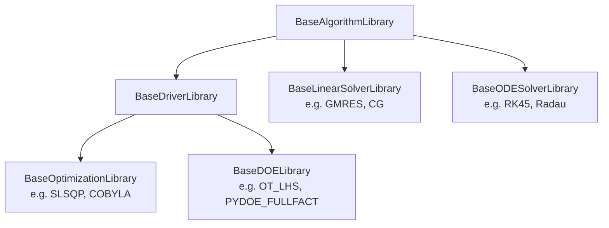

<!--
 Copyright 2021 IRT Saint Exupéry, https://www.irt-saintexupery.com

 This work is licensed under the Creative Commons Attribution-ShareAlike 4.0
 International License. To view a copy of this license, visit
 http://creativecommons.org/licenses/by-sa/4.0/ or send a letter to Creative
 Commons, PO Box 1866, Mountain View, CA 94042, USA.
-->

# Algorithms { #concept-algorithms }

GEMSEO solves numerical problems with algorithms of four families.

| Family                      | Package                                      | Description                              |
| --------------------------- | -------------------------------------------- | ---------------------------------------- |
| Optimization                | [`gemseo.optimization`][gemseo.optimization] | [Optimizers][concept-optimizers]         |
| Design of experiments (DOE) | [`gemseo.doe`][gemseo.doe]                   | [Samplers (DOE)][concept-samplers-doe]   |
| Linear solvers              | [`gemseo.linear`][gemseo.linear]             | [Linear solvers][concept-linear-solvers] |
| ODE solvers                 | [`gemseo.ode`][gemseo.ode]                   | [ODE solvers][concept-ode-solvers]       |

GEMSEO does not rewrite solvers that already exist.
It wraps them and gives them a common interface,
so that switching from one solver to another is only a matter of settings.
In some rare occasions,
GEMSEO implements a few algorithms itself,
e.g. the augmented Lagrangian.

## Algorithm types { #concept-algorithm-types }

Each family is split into algorithm libraries.
They all derive from
[BaseAlgorithmLibrary][gemseo.core.algorithm.base_algorithm_library.BaseAlgorithmLibrary].
A library can wrap several algorithms of the same third-party package.
For each of them,
an [AlgorithmDescription][gemseo.core.algorithm.base_algorithm_library.AlgorithmDescription]
records:

- its name in GEMSEO,
- its name in the wrapped package,
- the name of the wrapped package and a web page documenting the algorithm,
  when they are given,
- a short description,
- its settings class.

The optimization and DOE libraries are called drivers.
They derive from
[BaseDriverLibrary][gemseo.core.algorithm.base_driver_library.BaseDriverLibrary].

A driver iterates on the input space of the problem.
An optimizer starts from the current value of a [design space][concept-design-space].
A DOE algorithm also accepts a [random space][concept-random-space],
which has no current value.

??? note "What each family adds to the description"
    Each family adds to this description what its algorithms can handle:

    - drivers
    ([DriverDescription][gemseo.core.algorithm.base_driver_library.DriverDescription]):
    integer, discrete, catalog and categorical variables;
    - optimizers
    ([OptimizationAlgorithmDescription][gemseo.optimization.core.base_optimization_library.OptimizationAlgorithmDescription]):
    equality constraints, inequality constraints, several objectives,
    need for the gradient,
    restriction to linear problems;
    - DOE algorithms
    ([DOEAlgorithmDescription][gemseo.doe.core.base_doe_library.DOEAlgorithmDescription]):
    minimum dimension of the input space;
    integer, discrete and categorical variables are accepted by default;
    - linear solvers
    ([LinearSolverDescription][gemseo.linear.core.base_linear_solver_library.LinearSolverDescription]):
    whether the left-hand side matrix must be symmetric
    or positive definite.

## Suitability to a problem { #concept-algorithm-suitability }

The description of an algorithm tells which problems it can solve.
An algorithm is rejected when:

- the input space is empty,
- the problem has a type of variable that the driver does not accept,
- the problem has constraints that the optimizer cannot handle,
- the optimizer is restricted to linear problems and the problem is not linear,
- the problem has fewer dimensions than the DOE algorithm requires,
  e.g. 3 for the Box-Behnken design `PYDOE_BBDESIGN`,
- the left-hand side matrix is not declared symmetric or positive definite
  while the linear solver requires it.

A driver runs this check before solving.
If the algorithm is rejected,
it raises an error stating the reason.
A linear solver does not run it:
the check only serves to select the suited solvers,
and relies on what the user declares about the left-hand side
(`is_symmetric` and `is_positive_def` in
[LinearProblem][gemseo.linear.problem.LinearProblem], both `False` by default).

An algorithm can still be used on a problem
with a type of variable that it does not accept,
when a transformation turns this problem into one that the algorithm accepts,
see [Transformations][concept-algorithm-transformations].

## Transformations { #concept-algorithm-transformations }

A driver does not always iterate on the problem the user built.
It can iterate on a working problem,
derived from it by space transformations.
A transformation changes the problem,
not only its input space.

The working problem has its own input space and its own functions.
Its input space is the working space of the transformations.
Its objective, constraints and observables are the ones of the user,
composed with the map from the working space back to the declared one.
Their Jacobians are mapped to the working space too.
The functions of the user are still evaluated in the declared coordinates
and the database records the points there.

The transformations are defined in
[`gemseo.space.transformation`][gemseo.space.transformation].

Most drivers apply the following transformations, in this order:

- [SpaceRelaxation][gemseo.space.transformation.SpaceRelaxation]
  replaces the integer and discrete variables by float ones
  with the same bounds.
  The settings `relax_integer_variables` and `relax_discrete_variables` enable it.
  It relaxes only the kinds of variables that the algorithm does not handle.
  The functions then receive the relaxed values:
  an integer variable can take a non-integral value.
- [SpaceNormalization][gemseo.space.transformation.SpaceNormalization]
  maps each component with finite bounds to $[0, 1]$.
  The setting `normalize_design_space` enables it.
  It leaves unchanged a component without finite bounds,
  and an integer, discrete or categorical component.
  A relaxed integer or discrete component is a float one,
  so it is normalized,
  e.g. $n = 4$ in $[1, 10]$ becomes $1/3$.

These two transformations only change the coordinates:
at matching points,
the functions take the same values,
e.g. with $x$ in $[-2, 4]$ normalized,
the working objective at $u = 0.5$ is $f(1)$,
and its derivative with respect to $u$ is $6$ times the one with respect to $x$.

??? note "Composition of the transformations"
    [SpaceComposition][gemseo.space.transformation.SpaceComposition]
    chains the transformations.
    Without any of them,
    the composition is empty and behaves like the identity:
    its working space is the declared space itself.

The types of variables are checked after the transformations.
A type that a transformation removes does not reject the algorithm.
No transformation applies to catalog and categorical variables,
so an algorithm that does not handle them is rejected.

The result is projected once onto the domain the user declared,
after the run.
An integer value is rounded
and a discrete value is moved to the nearest choice.

??? note "Details of the projection"
    The projection is not applied at each evaluation:
    it would turn a relaxed function into a step function
    and set its gradient to zero.
    An [OptimizationResult][gemseo.optimization.result.OptimizationResult]
    keeps the optimum found by the algorithm in `x_opt`.
    It stores the projected optimum in `x_opt_projected`,
    the objective at this point in `f_opt_projected`
    and its feasibility in `is_feasible_projected`.
    The design space receives the projected optimum.
    For instance,
    minimizing $(x - 1)^2 + (n - 6.3)^2$
    with $x$ in $[-2, 4]$ and an integer $n$ in $[1, 10]$
    by SLSQP with `relax_integer_variables=True`
    gives `x_opt` $= (1, 6.3)$ and `f_opt` $= 0$,
    then `x_opt_projected` $= (1, 6)$ and `f_opt_projected` $= 0.09$.

??? note "Drivers applying no transformation"
    A few drivers iterate on the problem the user built.
    A driver handing sub-problems to sub-drivers,
    such as the multi-start optimizer or the augmented Lagrangian,
    leaves the transformations to its sub-drivers,
    which apply their own according to their settings.
    The linear programming drivers `ScipyLinprog` and `ScipyMILP`
    read the coefficients of the functions and the bounds
    in the coordinates the user declared.
    Setting `normalize_design_space` to `True` for any of them only logs a warning.

!!! how-to
    - [Record the evaluations in the coordinates of the algorithm][]

## Settings { #concept-algorithm-settings }

Each algorithm has its own [settings][settings-user-guide] class.
Since this class identifies the algorithm,
the settings alone select it.

??? note "Base settings class of each family"
    Within a family,
    the settings share a base class:

    - [BaseOptimizerSettings][gemseo.optimization.core.base_optimizer_settings.BaseOptimizerSettings]
      for the optimizers,
    - [BaseDOESettings][gemseo.doe.core.base_doe_settings.BaseDOESettings]
      for the DOE algorithms,
    - [BaseLinearSolverSettings][gemseo.linear.core.base_linear_solver_settings.BaseLinearSolverSettings]
      for the linear solvers,
    - [BaseODESolverSettings][gemseo.ode.core.base_ode_solver_settings.BaseODESolverSettings]
      for the ODE solvers.

The optimization and DOE settings also derive from
[BaseDriverSettings][gemseo.core.algorithm.base_driver_settings.BaseDriverSettings],
which covers:

- the tolerances on the equality and inequality constraints
  (default: $10^{-2}$ and $10^{-4}$),
- the maximum runtime,
- the scaling of the design variables between 0 and 1
  (enabled by default for most optimizers, disabled for the DOE algorithms),
- the storage of the evaluations and Jacobian matrices in the database,
- the evaluation of the Jacobians of the observables
  (disabled by default),
- the relaxation of the integer and discrete variables,
  see [Transformations][concept-algorithm-transformations],
- the logging of the problem and the progress bar,
- the reset of the iteration counters before each execution.

!!! tutorial
    - [Tutorial - Execute your first Multi-Disciplinary Optimization][tutorial-execute-your-first-multi-disciplinary-optimization]
    - [Tutorial - Execute your first Design of Experiment (DoE)][tutorial-execute-your-first-design-of-experiment-doe]

!!! how-to
    - [Define and solve an optimization problem][]

## Factories and discovery { #concept-algorithm-factories-and-discovery }

Each family has a factory of algorithm libraries.

??? note "Factory of each family"
    The factories derive from
    [BaseAlgorithmFactory][gemseo.core.algorithm.base_algorithm_factory.BaseAlgorithmFactory]:

    - [OptimizationLibraryFactory][gemseo.optimization.factory.OptimizationLibraryFactory],
    - [DOELibraryFactory][gemseo.doe.factory.DOELibraryFactory],
    - [LinearSolverLibraryFactory][gemseo.linear.factory.LinearSolverLibraryFactory],
    - [ODESolverLibraryFactory][gemseo.ode.factory.ODESolverLibraryFactory].

A factory lists the available libraries and algorithms.
Given the name of an algorithm,
it creates the matching library
and returns the settings class.
Given settings,
it executes a problem with the algorithm they name.

To find the libraries,
a factory looks for the subclasses of the base library of its family in:

- the package of the family,
- the directories of the environment variable `GEMSEO_PATH`,
- the packages declaring a `gemseo_plugins` entry point.

!!! note "Extensibility"
    A plugin can add algorithms to GEMSEO without modifying it.
    See [Extensibility][extensibility].
